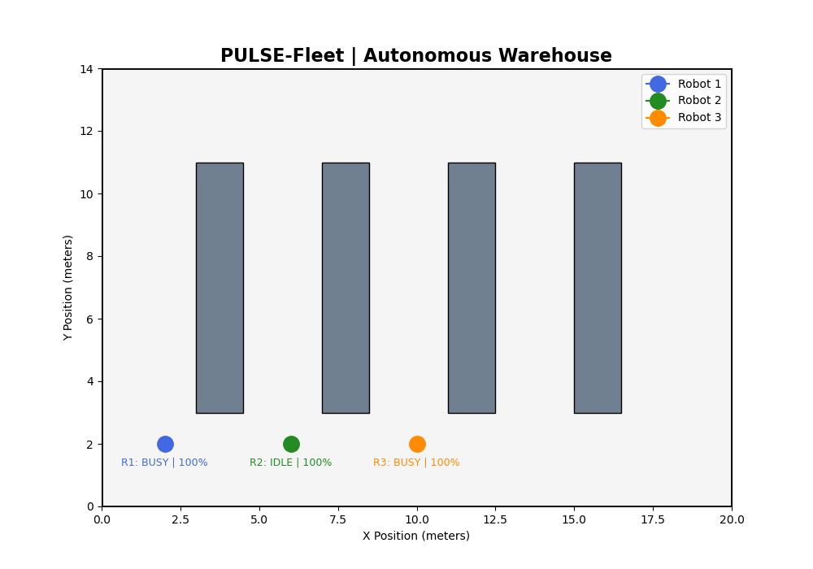

# PULSE-Fleet
### Decentralized Autonomous Warehouse Robot Fleet Management

PULSE-Fleet is an ongoing robotics software engineering project focused on decentralized coordination, distributed task allocation, and autonomous navigation for multiple autonomous mobile robots (AMRs) operating in a shared warehouse.

The project is developed using **ROS 2 Jazzy, Python, and Docker**, with an emphasis on fault-tolerant multi-robot communication and scalable software architecture.

**Current milestone:** Three independent ROS 2 State Managers communicate successfully, and a live warehouse dashboard monitors their status, battery levels, disconnections, and recovery.

---

## 1. Project Objectives

- Enable robots to coordinate without a centralized fleet controller.
- Implement decentralized communication and peer-state monitoring.
- Develop distributed task allocation using auction-based algorithms.
- Support autonomous navigation and coordinated task execution.
- Detect robot communication failures and recovery.
- Visualize multi-robot operations in 2D and, eventually, 3D.
- Evaluate the reliability and performance of decentralized fleet coordination.

---

## 2. System Architecture

Each robot is designed to operate three primary ROS 2 nodes.

### 2.1 State Manager — Implemented

The State Manager publishes the robot's own state and maintains information about other robots.

Implemented capabilities:

- Periodic heartbeats at approximately 1 Hz.
- Event-driven state updates.
- Peer-state monitoring.
- Stale-peer detection after approximately 3 seconds.
- Sequence numbers for message ordering.
- Session identifiers to distinguish robot restarts.
- Peer recovery when communication resumes.
- Independent operation across three robot instances.

### 2.2 Auction Agent — V1 Implemented and Tested

The Auction Agent enables decentralized task allocation in PULSE-Fleet using ROS 2 communication. Each robot independently receives warehouse tasks, calculates its bidding cost, exchanges bids with other robots, and determines the lowest-cost candidate without relying on a central auction server.

**Implemented capabilities (24 October 2026):**

- Shared warehouse task announcements through `/fleet/task_announcements`.
- Custom ROS 2 messages: `TaskAnnouncement.msg` and `TaskBid.msg`.
- Independent distance-based bid calculation using Euclidean distance.
- Bid publication and reception through `/fleet/task_bids`.
- Local bid storage organized by task ID and robot ID.
- Configurable auction collection window (default: 2 seconds).
- Independent minimum-cost winner selection with deterministic robot-ID tie-breaking.

**Bidding algorithm**

Each robot calculates the straight-line distance between its current position and the task destination:

\[
C_i = \sqrt{(x_g-x_i)^2+(y_g-y_i)^2}
\]

Where:

- \(C_i\) is Robot \(i\)'s bidding cost in meters.
- \((x_i,y_i)\) is the robot's position.
- \((x_g,y_g)\) is the task destination.

The robot with the lowest submitted cost is selected. Equal costs are resolved using robot IDs.

**Verified two-robot test — `task_007`**

Task destination: `(12.0, 8.0)` meters.

| Robot | Starting position | Calculated bid |
|---|---|---|
| robot_1 | (2.0, 2.0) | 11.6619 m |
| robot_2 | (10.0, 2.0) | 6.3246 m |

Both Auction Agents independently reported:

`Auction task_007 completed. Winner: robot_2, Cost: 6.32`

This demonstrates successful task announcement, bid exchange, bid storage, and basic decentralized winner computation.

**Current limitations and planned improvements**

- Robot positions are currently supplied through ROS 2 parameters rather than live localization.
- Straight-line distance does not account for warehouse obstacles or actual navigation path length.
- Identical winner decisions are not guaranteed when bids are delayed or lost.
- Task award confirmation, duplicate-task protection, conflict handling, and task reassignment remain to be implemented.
- Integration with the Navigation Controller, Nav2, and 3D warehouse simulation is planned.

The next development phase will focus on reliable task awards and commitments, followed by navigation integration and multi-robot simulation.

### 2.3 Navigation Controller — Planned

The Navigation Controller will handle robot movement and navigation.

Planned capabilities:

- Route and travel-cost estimation.
- Goal assignment and execution.
- Path planning and obstacle avoidance.
- Navigation feedback.
- Robot position updates.
- Integration with the Auction Agent for bid-cost estimation.

---

## 3. State Manager Communication Architecture

PULSE-Fleet uses a decentralized ROS 2 publish/subscribe architecture.

Each robot publishes its own state and subscribes to state messages from other robots through the shared topic:

`/fleet/robot_states`


*Figure 1. State Manager communication architecture showing three independent robot nodes exchanging state information through the shared ROS 2 topic. Heartbeats, session identifiers, sequence numbers, and timeout detection support peer monitoring and recovery.*

The shared topic provides communication infrastructure but does not act as a centralized fleet controller.

---

## 4. Custom ROS 2 Interface

The project defines a custom `RobotState.msg` interface.

```text
string robot_id
string session_id
uint64 sequence_number
float64 position_x
float64 position_y
float64 battery_percentage
string operating_status
string current_task_id
std_msgs/Header header

uint8 HEARTBEAT=0
uint8 STATE_CHANGE=1
uint8 update_type
```

The message contains robot identity, session information, state sequence, position, battery percentage, operating status, task assignment, timestamp, and update type.

Two update types are supported:

- `HEARTBEAT`: periodic state publication.
- `STATE_CHANGE`: immediate publication when relevant state changes.

---

## 5. Live Warehouse Visualization — Implemented

A lightweight 2D visualization has been developed using Python and Matplotlib.

The visualization includes:

- A warehouse layout measuring 20 × 14 meters.
- Four storage shelving sections.
- Three color-coded AMR markers.
- Live operating-status monitoring.
- Battery-percentage display.
- Automatic refresh approximately every second.
- Communication timeout detection.
- Automatic restoration of status after reconnection.

### Current Warehouse Visualization



*Figure 2. PULSE-Fleet warehouse visualization showing three AMRs and four shelving sections. At the moment captured, Robot 1 is BUSY, Robot 2 is IDLE, and Robot 3 is BUSY, with all three reporting 100% battery. Operating statuses and battery readings are obtained from ROS 2 state messages through the fleet-state bridge. Robot positions are currently illustrative; autonomous movement and live position tracking have not yet been implemented.*

### Visualization Architecture

```text
Robot 1 State Manager ──┐
                       │
Robot 2 State Manager ──┼──> /fleet/robot_states
                       │              │
Robot 3 State Manager ──┘              ▼
                              FleetStateBridge
                                       │
                                       ▼
                                fleet_state.json
                                       │
                                       ▼
                              Matplotlib Dashboard
                                       │
                                       ▼
                          Live Fleet Status Monitoring
```

The `FleetStateBridge` subscribes to the ROS 2 fleet-state topic and writes the latest robot information into a shared JSON file.

The Matplotlib visualization reads this file and updates the dashboard automatically.

This architecture allows the ROS 2 application to run inside Docker while the graphical visualization runs directly on macOS.

---

## 6. Robot Offline Detection and Recovery

Each robot's latest received state message is timestamped by the fleet-state bridge.

The visualization calculates:

```text
Time Since Last Message = Current Time - Last Seen Time
```

If a robot has not published a message for more than approximately 3 seconds, the dashboard displays:

`OFFLINE`

When the robot resumes communication, the dashboard automatically displays its newly reported operating status.

### Verified Test

A communication-failure test was performed with Robot 2.

1. All three robots initially communicated normally.
2. Robot 2's State Manager was stopped.
3. Robot 2 was displayed as `OFFLINE`.
4. Robots 1 and 3 remained online.
5. Robot 2's State Manager was restarted.
6. Communication resumed and its status reappeared automatically.

**Result: Passed.**

This demonstrates independent communication-failure detection and recovery in the monitoring system.

It does not yet demonstrate automatic task reassignment, which is planned for the Auction Agent.

---

## 7. Technology Stack

| Technology | Purpose |
|---|---|
| ROS 2 Jazzy | Distributed robotics middleware |
| Python | Application and coordination logic |
| rclpy | ROS 2 Python client library |
| Custom ROS 2 messages | Robot-state communication |
| Docker | Containerized ROS 2 development |
| Matplotlib | Live 2D warehouse visualization |
| JSON | Data exchange between ROS 2 and visualization |
| Git | Version control |
| GitHub | Source-code hosting and documentation |
| macOS | Host development environment |

---

## 8. Current Development Status

### Phase 1 — ROS 2 Foundations and State Communication

**Completed**

- ROS 2 Jazzy development environment.
- Docker-based ROS 2 workspace.
- Custom `RobotState.msg` interface.
- State Manager Python package.
- Three independent State Manager instances.
- Shared ROS 2 state topic.
- Periodic heartbeat publication.
- Event-driven state updates.
- Sequence numbers and session identification.
- Peer-state monitoring.
- Stale-peer detection and recovery.

### Phase 2 — Fleet Monitoring and Visualization

**Completed**

- Basic 2D warehouse layout.
- Three robot markers.
- ROS 2-to-JSON state bridge.
- Live operating-status monitoring.
- Live battery-percentage monitoring.
- Independent robot offline detection.
- Automatic dashboard recovery after reconnection.

**Future improvements**

- Dynamic robot-position updates.
- More informative offline indicators.
- Atomic JSON file updates.
- Automated monitoring tests.
- Performance and reliability measurements.

### Phase 3 — Distributed Task Allocation

**Next development phase**

- Task announcement interface.
- Auction Agent package.
- Bid-cost calculation.
- Distributed bid exchange.
- Deterministic winner selection.
- Task awards and commitments.
- Task reassignment after robot failure.

### Phase 4 — Autonomous Navigation

**Planned**

- Robot motion simulation.
- Route planning and cost estimation.
- Navigation Controller integration.
- Obstacle avoidance.
- Simultaneous task execution.
- Coordination between navigation and auctions.

### Phase 5 — 3D Warehouse Demonstration

**Planned**

- Lightweight 3D warehouse simulation.
- Three simulated AMRs.
- Autonomous task execution.
- Fleet monitoring and coordination.
- A 30–45-second recorded demonstration.

---

## 9. Development Roadmap

- [x] Configure ROS 2 Jazzy and Docker.
- [x] Create the ROS 2 workspace.
- [x] Implement custom robot-state messages.
- [x] Develop the State Manager.
- [x] Launch three communicating robot instances.
- [x] Implement heartbeat and event-driven updates.
- [x] Implement peer monitoring and recovery.
- [x] Create the 2D warehouse visualization.
- [x] Connect live ROS 2 state data to the dashboard.
- [x] Verify robot disconnection and recovery.
- [ ] Implement distributed task announcements.
- [ ] Implement auction-based bidding.
- [ ] Implement deterministic task allocation.
- [ ] Integrate navigation and robot movement.
- [ ] Implement task reassignment after failures.
- [ ] Build the 3D warehouse simulation.
- [ ] Record the final demonstration.
- [ ] Conduct systematic performance evaluation.

---

## 10. Testing and Validation

The following behaviors have been manually tested:

| Test | Result |
|---|---|
| Three independent State Managers | Passed |
| Shared state communication | Passed |
| Periodic heartbeat exchange | Passed |
| Event-driven status changes | Passed |
| Peer timeout detection | Passed |
| Peer recovery after restart | Passed |
| ROS 2-to-JSON data exchange | Passed |
| Live three-robot status updates | Passed |
| Dashboard offline detection | Passed |
| Dashboard recovery after reconnection | Passed |

Automated tests, load testing, and performance benchmarks are planned for later development.

---

## 11. Latest Development Milestone

**October 20, 2026 — Live Fleet Visualization and Fault Monitoring**

Implemented a working warehouse dashboard connected to three ROS 2 State Managers.

The system successfully displays robot operating states and battery percentages, detects individual communication failures, and restores robot status when communication resumes.

Git commit:

`8489c5d` — `feat: add live warehouse fleet visualization and offline detection`

---

## 12. Next Development Tasks

The next milestone focuses on decentralized task allocation.

Initial tasks:

1. Define the task announcement message.
2. Create the Auction Agent ROS 2 package.
3. Implement shared task announcements.
4. Design the bid-cost calculation.
5. Implement deterministic winner selection.
6. Validate auctions with three independent robots.

The objective is to allow robots to make coordinated task-allocation decisions without a centralized fleet controller.

---

## 13. Project Limitations

PULSE-Fleet is an active software-development project.

The following capabilities are not yet implemented:

- Autonomous robot navigation.
- Live physical or simulated robot movement.
- Distributed task auctions.
- Automatic task reassignment.
- Multi-robot collision avoidance.
- 3D warehouse simulation.

The current visualization demonstrates live communication and monitoring, not autonomous navigation.

---

## 14. Author

**Florian Muanda**

Robotics and AI Engineer

GitHub: https://github.com/flo-77

Portfolio: https://florian-muanda.netlify.app

---

**Project Status:** Active development.
